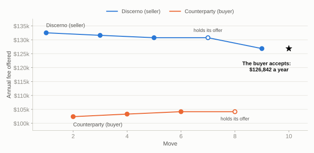
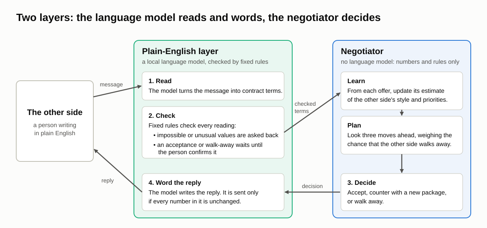

# Discerno

**An AI agent that negotiates a multi-term business contract, built from standard game-theory and negotiation techniques.**

Discerno negotiates a software (SaaS) contract renewal. It does not know what the other side cares about, so it learns that from the other side's offers, then decides at each move whether to accept, make a counteroffer or walk away. Its decisions come from explicit calculations, so persuasive wording cannot change them. A separate plain-English layer lets a person negotiate with it in ordinary language.

[How it works](docs/how-it-works.md) | [Examples](docs/examples.md) | [Testing](docs/testing.md) | [Plain-English mode](docs/plain-english.md) | [About](docs/about.md)

## One negotiation

Discerno sells a software subscription to a simulated buyer who cares most about service protection and who answers like with like (tit-for-tat).

After both sides hold their offers, Discerno breaks the deadlock at move 9. It adds the premium service tier and a larger service credit, which a protection-focused buyer values, and trims the fee. It keeps the terms that matter more to a seller: a 36-month contract and payment within 30 days. The buyer accepts.

| Final deal | Annual fee | Contract length | Payment due | Price-increase cap | Service tier | Service-breach credit |
|---|---:|---:|---:|---:|---|---:|
| Move 10 | $126,842 | 36 months | 30 days | 7.5% a year | Premium | 5% |

[Both example negotiations, move by move](docs/examples.md)

## The problem

In a contract renewal, price is only one of six terms on the table: the annual fee, the contract length, how soon payment is due, a cap on yearly price increases, the service tier and the credit paid if the service fails. A buyer may give up a little on price for a shorter contract or better protection. To bargain well, you need to know what the other side values, and they will not tell you.

## How it decides

Discerno has two layers.

- **The negotiator** uses no language model. It scores each contract package with a weighted formula. From the other side's offers it estimates two things: how they bargain (steady concessions, holding out until a deadline, or matching your moves) and which terms they care about most. It then looks three moves ahead, working backwards from where each move could lead (a technique called Bellman lookahead), and weighs the chance that the other side walks away. A message has no effect on a decision until it has been turned into numbers and checked.
- **The plain-English layer** uses a small language model, run on the author's computer, only to read the other side's message into contract terms and to word Discerno's reply. Fixed rules check every reading, and an acceptance or a walk-away does not count until the person confirms it.

[How it works, with a worked decision](docs/how-it-works.md)

## Does it work?

Discerno was tested in 4,000 simulated renewals, 2,000 as buyer and 2,000 as seller, against negotiators built from standard models of bargaining behavior.

- **Deals:** 77% of negotiations as buyer and 85% as seller ended in a deal. Every negotiation without a deal ended because the simulated opponent ran out of patience and left; Discerno never walked away.
- **Reading the other side:** by the end of a negotiation, Discerno had correctly identified the opponent's bargaining style in 79% of negotiations and its main priorities in 68%. Guessing would get each right 33% of the time.
- **Other strategies:** against four other negotiating strategies, three of them well known from negotiation research, 86% (as buyer) and 89% (as seller) of 1,600 negotiations ended in a deal.
- **Plain English:** in 37 hostile or tricky test messages, including attempts to trick the language model into accepting, Discerno never accepted below its walk-away line and no game ended without the person's confirmation.

These tests use simulated opponents. The next step is testing against people. [Testing in detail](docs/testing.md)

## Live negotiation on request

The interactive demo, with structured offers, plain-English play and a move-by-move replay of Discerno's reasoning, runs on the author's computer and is not hosted. A live negotiation with Discerno can be arranged on request: **taejun.oh5@gmail.com**.

## Built by

Taejun Oh: Ph.D. in economics from the University of Michigan (game theory), about ten years of strategy advisory and research work for senior management, and a Master of Computer Science at the University of Illinois Urbana-Champaign (completing in 2027). [About the project](docs/about.md)

The negotiator's source code is private. The material in this repository is covered by the [reuse terms](REUSE.md).
