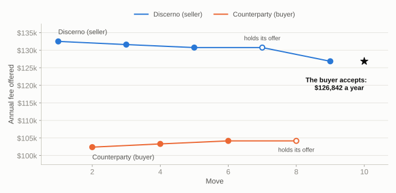
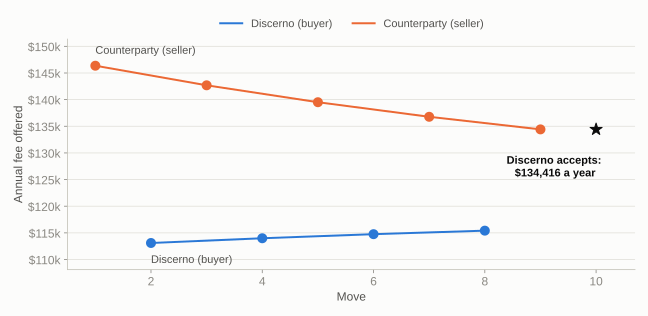

# Example negotiations

Two recorded negotiations from the simulation tests, one with Discerno as seller and one as buyer. Each chart shows the annual fee each side offered, move by move; the table below it shows all six terms. Both examples end in a deal and were chosen because they show Discerno's behavior clearly. The [testing page](testing.md) gives the results over thousands of negotiations.

How to read the terms: **length** is the contract term, **payment due** is the number of days the buyer has to pay each invoice, the **increase cap** limits yearly price rises, and the **breach credit** is the refund the buyer receives if the service misses its targets. A seller prefers a high fee, a long contract, early payment, a high cap, the standard tier and a small credit; a buyer prefers the opposite.

## Discerno as seller: breaking a deadlock

The simulated buyer cares most about service protection (the service tier and the breach credit) and bargains tit-for-tat: it gives ground when Discerno does and holds when Discerno holds.

| Move | Who | Action | Annual fee | Length | Payment due | Increase cap | Service tier | Breach credit |
|---:|---|---|---:|---:|---:|---:|---|---:|
| 1 | Discerno | Opens | $132,500 | 36 months | 30 days | 8.0% | Standard | 2.0% |
| 2 | Buyer | Offers | $102,386 | 12 months | 90 days | 0.0% | Premium | 20.0% |
| 3 | Discerno | Offers | $131,596 | 36 months | 30 days | 7.8% | Standard | 2.5% |
| 4 | Buyer | Offers | $103,304 | 12 months | 60 days | 0.5% | Premium | 19.6% |
| 5 | Discerno | Offers | $130,747 | 36 months | 30 days | 7.5% | Standard | 3.0% |
| 6 | Buyer | Offers | $104,166 | 12 months | 60 days | 0.9% | Premium | 19.1% |
| 7 | Discerno | Holds its offer | $130,747 | 36 months | 30 days | 7.5% | Standard | 3.0% |
| 8 | Buyer | Holds its offer | $104,166 | 12 months | 60 days | 0.9% | Premium | 19.1% |
| 9 | Discerno | Offers | $126,842 | 36 months | 30 days | 7.5% | Premium | 5.0% |
| 10 | Buyer | **Accepts** | $126,842 | 36 months | 30 days | 7.5% | Premium | 5.0% |

**What happened.** For the first six moves both sides give ground slowly, mostly on the fee, the increase cap and the credit. At move 7 Discerno repeats its offer unchanged, and at move 8 the buyer does the same. A tit-for-tat negotiator answers a hold with a hold, which is the response Discerno's holding test looks for (see [How it works](how-it-works.md#3-gather-information-and-test)). At move 9 Discerno offers what this buyer values: the premium service tier and a larger credit, with a fee about $3,900 lower. It keeps the terms a seller values more, the 36-month contract and payment within 30 days. The buyer accepts.

## Discerno as buyer: taking a package that moved its way

The simulated seller cares most about money (the fee and the increase cap) and gives ground at a steady pace.

| Move | Who | Action | Annual fee | Length | Payment due | Increase cap | Service tier | Breach credit |
|---:|---|---|---:|---:|---:|---:|---|---:|
| 1 | Seller | Opens | $146,362 | 36 months | 30 days | 8.0% | Standard | 2.0% |
| 2 | Discerno | Offers | $113,098 | 12 months | 90 days | 0.0% | Premium | 20.0% |
| 3 | Seller | Offers | $142,686 | 24 months | 60 days | 6.1% | Premium | 6.3% |
| 4 | Discerno | Offers | $113,986 | 12 months | 90 days | 0.2% | Premium | 19.6% |
| 5 | Seller | Offers | $139,514 | 24 months | 60 days | 4.7% | Premium | 9.4% |
| 6 | Discerno | Offers | $114,752 | 12 months | 90 days | 0.3% | Premium | 19.3% |
| 7 | Seller | Offers | $136,778 | 24 months | 60 days | 3.7% | Premium | 11.8% |
| 8 | Discerno | Offers | $115,413 | 12 months | 90 days | 0.4% | Premium | 19.1% |
| 9 | Seller | Offers | $134,416 | 12 months | 90 days | 2.9% | Premium | 13.5% |
| 10 | Discerno | **Accepts** | $134,416 | 12 months | 90 days | 2.9% | Premium | 13.5% |

**What happened.** Discerno's first offer has a low fee and every other term in the buyer's favor; after that it concedes only small amounts. The seller lowers the fee by between about $2,400 and $3,700 at each of its moves. At move 9 the seller also gives Discerno a 12-month contract and 90 days to pay, and lowers the increase cap to 2.9%. Discerno accepts. The fee is about $19,000 above Discerno's own last offer, but every other term has moved its way, and Discerno's calculation valued this package above bargaining on, given the chance that the seller walks away.

## Replay

The [replay page](https://tj-overflow.github.io/discerno_public/demos/replay.html) plays back both negotiations step by step, with all six terms and play and step controls. It only replays these two recorded games. Its source is [`demos/replay.html`](../demos/replay.html).

A live negotiation with Discerno, including plain-English play and a replay of its reasoning, can be arranged on request: **taejun.oh5@gmail.com**.

[Back to Discerno](../README.md)
