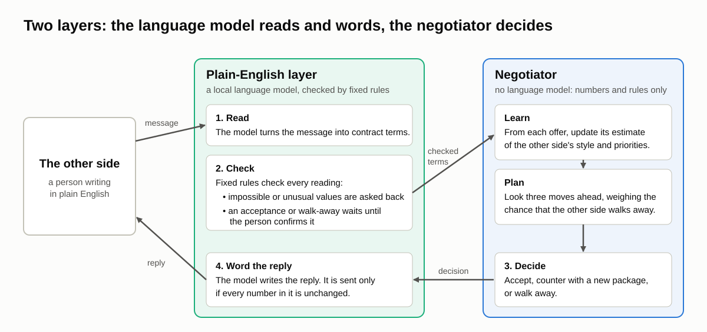

# How Discerno works

Discerno has two layers. The **negotiator** makes every decision with explicit calculations and uses no language model. The optional **plain-English layer** uses a language model only to read messages into numbers and to word replies; [its page](plain-english.md) covers it. This page explains the negotiator in five steps, with a worked decision at the end.

## 1. Score a whole package

A contract renewal has six terms: the annual fee, the contract length (12, 24 or 36 months), payment due (30, 60 or 90 days), a cap on yearly price increases (0 to 10%), the service tier (standard or premium) and the service-breach credit (0 to 20%). Discerno scores a complete package with a weighted sum: each term gets a weight for how much it matters, so a lower fee can be traded against, say, a longer contract. Economists call this a multi-attribute utility function.

Discerno also has a **walk-away line**: the lowest score it will ever accept. It knows its own weights and walk-away line. It does not know the other side's.

## 2. Learn about the other side

Discerno keeps a set of possible explanations for how the other side behaves, and a probability for each. The explanations combine two questions:

| Question | Possible answers |
|---|---|
| How do they bargain? | **Steady:** give ground at a regular pace. **Deadline:** hold firm, then concede quickly as time runs out. **Tit-for-tat:** give ground when you do and hold when you hold. |
| What do they care about most? | **Money:** the fee and the increase cap. **Timing:** the contract length and when payment is due. **Protection:** the service tier and the breach credit. |

That makes nine combinations, plus a "none of the above" option for an opponent that fits no pattern. These three bargaining styles are standard models in negotiation research.

After each offer, Discerno asks how well each explanation predicted what the other side just did, and shifts probability toward the explanations that predicted it well. This is Bayesian-style updating. It looks at five kinds of evidence:

- how far the other side moved compared with what each style predicts;
- which terms they changed and which they protected;
- whether their moves follow Discerno's own moves (the tit-for-tat signature);
- how they responded when Discerno held its offer (step 3);
- whether their concessions are speeding up, as a deadline negotiator's do.

Discerno keeps the whole set of probabilities when it plans. It does not bet everything on the single most likely explanation.

## 3. Gather information, and test

For the first few moves Discerno makes simple, modest concessions while it learns. It can still accept a good offer during this period.

Sometimes it **holds**: it repeats its previous offer unchanged. A tit-for-tat negotiator tends to answer a hold with a hold, while a steady or deadline negotiator tends to keep moving, so the response tells Discerno something. Holding has a cost (it delays progress), so Discerno uses it only when there is still something worth learning and time to spare. The [seller example](examples.md#discerno-as-seller-breaking-a-deadlock) shows a hold answered by a hold.

## 4. Plan three moves ahead

After the information-gathering period, Discerno plans. For each counteroffer it might make, it asks: what could happen next?

- The other side might accept.
- The other side might walk away. The longer bargaining drags on, the more likely that becomes.
- The other side might counter, and bargaining continues.

It works out each branch for each explanation from step 2, weights the results by how likely each explanation is, and repeats this for up to three of its own future moves. Working backwards from where each move could lead in this way is called Bellman lookahead (dynamic programming). The result is a value for each possible counteroffer.

## 5. Decide

Discerno accepts the other side's offer if it clears the walk-away line and is worth at least as much as bargaining on. Otherwise it makes the best counteroffer from step 4. It can also end the negotiation itself, though it never did so in the simulation tests.

To avoid betting on one optimistic forecast, the value of bargaining on is a cautious figure: the average of the best counteroffer's value and the average value of all the counteroffers it considered.

## A worked decision

This illustration uses simple made-up numbers. Discerno is the buyer. Scores run from 0 to 100, and its walk-away line is 45.

| Package | Annual fee | Contract length | Service tier | Score for Discerno |
|---|---:|---:|---|---:|
| A: the seller's offer on the table | $120,000 | 12 months | Standard | 60 |
| C: a possible counteroffer | $120,000 | 36 months | Premium | 70 |

C scores higher, so should Discerno reject A and propose C? Suppose its planning gives these prospects for C:

| If Discerno proposes C | Probability | Score on that branch |
|---|---:|---:|
| The seller accepts | 60% | 70 |
| The seller walks away | 10% | 0 (no deal) |
| The seller counters and bargaining continues | 30% | 50 (expected value of continuing) |

1. **Value of proposing C:** 0.60 × 70 + 0.10 × 0 + 0.30 × 50 = **57**.
2. **Cautious value of bargaining on:** suppose 57 is the best of the counteroffers considered and their average is 51. The average of the two is (57 + 51) / 2 = **54**.
3. **Compare:** A scores 60. That is above the walk-away line (45) and above the value of bargaining on (54).
4. **Decide:** accept A. C would be better if the seller accepted it, but the risk of losing the deal makes proposing it worth less than taking A now.

[Examples](examples.md) | [Testing](testing.md) | [Back to Discerno](../README.md)
