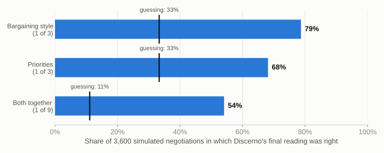

# Testing

Discerno was tested in simulated contract renewals: thousands of complete negotiations against computer-run opponents whose bargaining styles and priorities follow standard models from negotiation research. This page describes the simulated setting, then the results.

## The simulated renewal

The setting is built to resemble the renewal of a business software subscription.

- **Six terms are negotiated together:** the annual fee, the contract length (12, 24 or 36 months), payment due (30, 60 or 90 days), a cap on yearly price increases (0 to 10%), the service tier (standard or premium) and the credit paid if the service misses its targets (0 to 20%).
- **Each negotiation starts from a different contract,** with a current annual fee between $80,000 and $150,000.
- **Buyer and seller want opposite things** on every term, and each has a private walk-away line, drawn afresh for each negotiation.
- **Time matters.** The two sides take turns making offers, and the simulated opponents become more likely to walk away the longer bargaining drags on.

**The opponents.** Each opponent combines one of three bargaining styles with one of three sets of priorities, the same nine combinations Discerno tries to identify ([How it works](how-it-works.md#2-learn-about-the-other-side)):

| Bargaining style | Behavior |
|---|---|
| Steady | Gives ground at a regular pace; the pace differs from one opponent to the next |
| Deadline | Holds firm, then concedes quickly as time runs out |
| Tit-for-tat | Gives ground when the other side does, holds when it holds |

| Priorities | Terms that matter most |
|---|---|
| Money | The annual fee and the increase cap |
| Timing | The contract length and when payment is due |
| Protection | The service tier and the breach credit |

A tenth opponent makes unpredictable offers, to test Discerno against behavior that fits none of its explanations. These are design assumptions chosen to resemble a real renewal (a finance-led buyer, a cash-flow-led buyer, an operations-led buyer, and the familiar bargaining styles); they were not fitted to data from real negotiations.

Discerno played 200 negotiations against each of the ten opponents, as buyer and again as seller: 4,000 negotiations in all.

## Results

### Deals

| | Discerno as buyer | Discerno as seller |
|---|---:|---:|
| Negotiations | 2,000 | 2,000 |
| Ended in a deal | 77% | 85% |
| Ended because the opponent walked away | 23% | 15% |
| Ended because Discerno walked away | 0 | 0 |

Every negotiation without a deal ended with the simulated opponent running out of patience.

### Reading the other side

At the end of each negotiation, Discerno's most likely explanation was compared with the opponent's true style and priorities. The unpredictable opponent is left out, since it has no true style to identify.

| Correctly identified | Discerno as buyer | Discerno as seller | Guessing |
|---|---:|---:|---:|
| Bargaining style | 79% | 79% | 33% |
| Priorities | 66% | 70% | 33% |
| Both | 52% | 56% | 11% |

Each role covers 1,800 negotiations against the nine modeled opponents. The chart combines both roles.

### Against other strategies

Discerno also played four opponents it was not designed around, 200 negotiations each as buyer and as seller. Three are well-known agents from automated-negotiation research, adapted to this contract; the fourth is a simple planner that looks only one move ahead and does not learn.

| Opponent | Deals, Discerno as buyer | Deals, Discerno as seller |
|---|---:|---:|
| Boulware (Faratin and colleagues, 1998): holds firm, concedes late | 80% | 79% |
| Nice Tit-for-Tat (Baarslag and colleagues, 2013): matches the other side's concessions | 100% | 100% |
| AgentK: winner of the first international Automated Negotiating Agents Competition (2010) | 64% | 84% |
| One-move planner | 100% | 95% |
| **All four** | **86%** | **89%** |

As in the main tests, every negotiation without a deal ended with the opponent walking away.

### Plain-English mode

The plain-English layer was tested separately with 37 hostile or tricky messages. Discerno never accepted below its walk-away line, and no game ended without the person's confirmation. [Details](plain-english.md#test-results).

## What the tests do not show

All opponents here are simulated, and their styles and priorities come from the models described above. The results show Discerno working as designed in a setting built to resemble a real renewal. How it performs against people, whose behavior need not follow these models, is still to be tested; that is the next step.

[How it works](how-it-works.md) | [Examples](examples.md) | [Back to Discerno](../README.md)
